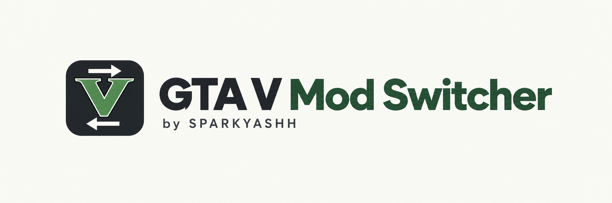

# GTA V Mod Switcher by SPARKYASHH

A portable Windows GUI for moving selected GTA V mod components out of the game directory and restoring them with one button.

**Version 0.1 is a preview. Windows CI passed: 26 assertions on Windows PowerShell 5.1, 26 on PowerShell 7, plus the Windows Forms smoke test. The user confirmed disable, restore and saved settings after restart on their Legacy installation. Other installations still need validation.**

[Download tested preview](https://github.com/SPARKYASHH/GTAV-Mod-Switcher/archive/refs/heads/main.zip) · [Windows test results](https://github.com/SPARKYASHH/GTAV-Mod-Switcher/actions/runs/41318521549)

The ZIP includes the application and its source files; extract everything before launching. No GitHub sign-in is required for this source ZIP. No stable release has been published yet.

[Подробная инструкция на русском](README_RU.md)

## Quick start

1. Extract outside the game directory and mod storage. Keep all application files together.
2. Launch `START.cmd`. This preview automatically runs isolated temporary-file and GUI smoke tests before opening the main window. If a test fails, the main window is not opened. `RUN-TESTS.cmd` runs checks separately.
3. After successful checks, the main window opens. Use Windows 10/11 with built-in Windows PowerShell 5.1. No Python or additional library installation is required.
4. Browse to your game directory, or paste its path and press Enter. Legacy (`GTA5.exe`) and Enhanced (`GTA5_Enhanced.exe`) paths are recognized; Enhanced has not been validated on a real installation.
5. Review the component groups and their exact contents. Close GTA V, then disable selected groups.
6. Press the same button again to restore all components disabled by this application. Checkboxes control the next disable operation, not restoration.

Profiles and selections are remembered per installation. Storage is automatically created beside the game directory on the same drive: `<game-directory-name>-SPARKYASHH-ModStorage/DisabledFiles`. Do not delete/move storage while it contains mods.

Groups include `mods`, Menyoo, ASI loader/Script Hook V, ScriptHookVDotNet, scripts, other ASIs, optional graphics proxies, and optional whole `commandline.txt`. Custom files/folders can be selected from the game root. Known original components, root RPF archives and EXEs are blocked. This is not a complete original-file database. Graphics candidates are unchecked by default and require review.

The tool uses same-drive moves, rejects overwrite/merge conflicts, records a recovery journal and rolls back ordinary failures. After interruption, **Восстановить** (Recover) restores the state before the interrupted operation. No other processes are killed. Close GTA, OpenIV and Explorer windows accessing mod files if access is denied. Automatic lock-owner identification is not implemented.

Before migrating from the old ModSwitch v2, restore all mods using the old switcher first. Old storage is not imported automatically.

This tool does not certify an Online-compatible installation. It does not restore original archives, change BattlEye or launcher options, or detect every possible mod. `START.cmd` sets execution-policy bypass only for its PowerShell process; it does not change machine-wide policy or bypass organizational restrictions.

## App icon and desktop shortcut

Run `CREATE-SHORTCUT.cmd` to create a desktop shortcut with the GTA V / MODS switch icon. Keep the application in its final location before creating the shortcut. The shortcut launches `START.cmd`, including preview checks.

The icon artwork was image-generated. GTA V branding belongs to its respective owners; the code MIT license does not grant trademark rights. This is an unofficial utility.

## Development

Run `tests/Core.Tests.ps1` in Windows PowerShell 5.1 and PowerShell 7, then run `ModSwitch.ps1 -SmokeTest` on Windows. Tests cover round-trip preservation, preflight conflicts, path/original-file protection, injected move failure rollback, crash recovery, exclusive storage locking and unknown stored files.

The included GitHub Actions workflow runs Windows tests and uploads a portable test package only after success. It does not publish a release. A real-installation acceptance test is still required before release.

By **SPARKYASHH**. Independent, unofficial software; not affiliated with Rockstar Games. MIT licensed. Based on the user's supplied ModSwitch v2 logic.
