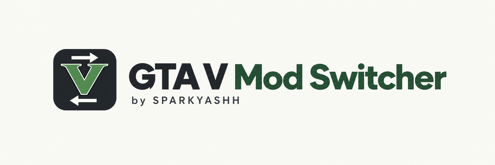

# GTA V Mod Switcher by SPARKYASHH

Оконный переключатель выбранных модов GTA V для Windows. Укажите папку игры один раз, отметьте группы — затем отключайте и возвращайте моды одной кнопкой.

**0.1 — предварительная версия. Автоматические тесты Windows успешно пройдены: 26 проверок в PowerShell 5.1, 26 в PowerShell 7 и проверка интерфейса. Пользователь подтвердил отключение, возврат модов и сохранение настроек после перезапуска на своей установке Legacy. Другие конфигурации ещё предстоит проверить.**

[Скачать проверенную тестовую сборку](https://github.com/SPARKYASHH/GTAV-Mod-Switcher/archive/refs/heads/main.zip) · [Результаты проверок](https://github.com/SPARKYASHH/GTAV-Mod-Switcher/actions/runs/41318521549)

ZIP включает программу и исходники; распакуйте его целиком перед запуском. Для скачивания вход в GitHub не требуется. Также доступно **Code → Download ZIP**. Публичного стабильного релиза пока нет.

## Запуск

1. Распакуйте архив в отдельную папку **вне GTA и хранилища модов**. Сохраните вместе `START.cmd`, `ModSwitch.ps1` и `ModSwitch.Core.ps1`.
2. Запустите `START.cmd`: перед открытием основного окна эта предварительная версия автоматически проверяет операции на временных тестовых файлах и компоненты интерфейса без обращения к вашей GTA. При ошибке окно управления модами не откроется. `RUN-TESTS.cmd` позволяет отдельно повторить те же проверки.
3. После успешных тестов откроется окно. Требуются Windows 10/11 и встроенный Windows PowerShell 5.1; Python, OpenIV и установка библиотек для самой программы не требуются.
4. Нажмите «Обзор…» или вставьте путь в поле и нажмите Enter. Нужна папка с `GTA5.exe` (Legacy) или `GTA5_Enhanced.exe` (Enhanced).
5. Проверьте галочки. Щёлкните название группы: справа показываются точные имена её компонентов и их расположение.
6. Закройте игру и нажмите «Отключить выбранные моды».
7. Для возврата нажмите «Включить отключённые моды». Возвращаются **все** временно отключённые этой программой компоненты; текущие галочки относятся только к следующему отключению.

Настройки и последние пути сохраняются автоматически. Несколько установок GTA выбираются в выпадающем списке. Профиль, хранилище и набор выбранных групп у каждой установки отдельные. Наличие имени EXE проверяется; совместимость самих игровых модов программа не проверяет. Enhanced ещё не проверена на реальной установке.

`START.cmd` использует `ExecutionPolicy Bypass` только для своего процесса PowerShell; системная политика не меняется. Обход корпоративных политик не выполняется. Администратор автоматически не запрашивается. Обычно обычного запуска достаточно, если у пользователя есть права на папку игры и соседнюю папку.

## Иконка и ярлык

В комплекте есть иконка Windows `assets/app.ico` с упрощённой V и стрелками переключения. Она используется в окне программы. Для ярлыка с этой иконкой запустите `CREATE-SHORTCUT.cmd`. Ярлык появится на рабочем столе и будет запускать `START.cmd` с предварительными проверками. Не переносите папку программы после создания ярлыка; при переносе создайте ярлык заново.

Графика иконки создана с помощью генерации изображений. Логотип GTA V и связанные обозначения принадлежат их правообладателям; MIT-лицензия кода не предоставляет прав на эти знаки. Иконка обозначает неофициальную утилиту.

## Группы и свои файлы

- Архивы: `mods`.
- Menyoo: `Menyoo.asi`, `menyooStuff`, `Menyoo.log`.
- Загрузчик ASI / Script Hook V: `dinput8.dll`, `ScriptHookV.dll` и известные журналы.
- ScriptHookVDotNet: ASI, библиотеки, конфигурации, журнал.
- Скрипты: `scripts`.
- Остальные найденные `.asi`.
- Графика / proxy DLL: распространённые имена ReShade, ENB и DLL. **По умолчанию не выбраны**: совпадение имени само по себе не доказывает, что файл является модом. Комплект конкретного графического мода может требовать дополнительных файлов.
- `commandline.txt`: отдельная необязательная группа. Перемещается целиком, содержимое не редактируется.

«Добавить файл…» и «Добавить папку…» позволяют включить собственные компоненты непосредственно из корня GTA. Для вложенных файлов выберите их корневую папку целиком. Программа отклоняет известные оригинальные папки, EXE и корневые RPF. Список защиты не является полным каталогом оригинальных файлов всех сборок игры: произвольные компоненты выбирайте осознанно.

Группы — удобные наборы имён, а не универсальное определение зависимостей любых модов. Новые файлы не добавляются в сохранённый выбор без проверки пользователем. «Обновить список» повторно сканирует папки.

## Хранилище

Создаётся автоматически на том же диске, рядом с GTA. Например:

- Игра: `F:\RGL\Grand Theft Auto V Legacy`
- Хранилище: `F:\RGL\Grand Theft Auto V Legacy-SPARKYASHH-ModStorage`
- Отключённые компоненты: подпапка `DisabledFiles`.

Папки и файлы переименовываются/перемещаются внутри одного диска. Рекурсивного копирования или удаления модов нет. Моды не объединяются с уже существующими папками. Кнопка «Открыть хранилище» показывает место хранения.

Не удаляйте и не переносите хранилище, пока в нём лежат моды. Чтобы удалить программу: сначала верните компоненты в игру, затем удалите файлы программы. Хранилище можно убрать после проверки пустой `DisabledFiles`; настройки находятся в `%LOCALAPPDATA%\SPARKYASHH\GTAVModSwitcher`.

## Ошибки и восстановление

Перед первым перемещением проверяются конфликты выбранного набора. Если копии есть в обеих папках, программа отказывается их перезаписывать. Сравните обе копии и вручную перенесите лишнюю в отдельную резервную папку; затем обновите список.

При обычной ошибке выполняется возврат уже перемещённых компонентов. При закрытии процесса/сбое состояние восстанавливается по `operation.json` с проверкой фактического расположения каждого компонента. Кнопка «Восстановить» возвращает **состояние до прерванной операции** — это может означать как включение, так и отключение модов. Следующее переключение блокируется до восстановления.

Если восстановлению мешают две копии либо пропавший файл, сначала устраните эту причину. Не удаляйте журналы ради снятия блокировки. При потере питания полная сохранность данных зависит и от файловой системы/диска; журнал не заменяет резервную копию важных файлов.

«Отказано в доступе» может означать занятые файлы или недостаточные права. Закройте GTA, OpenIV и окна Проводника, работающие с этими папками. Не нужно завершать неизвестные процессы или принудительно закрывать их файловые дескрипторы. Программа сама чужие процессы не завершает. Конкретный владелец блокировки пока автоматически не определяется.

## Переход со старого ModSwitch v2

Сначала **старой программой включите обратно все моды** из старого хранилища. Убедитесь, что его `DisabledFiles` пуста. Только затем настраивайте новую программу. Старое хранилище автоматически не импортируется: это предотвращает путаницу между двумя журналами и наборами файлов.

## Online и область действия

Программа сообщает «выбранные моды отключены», а не гарантирует чистую установку для Online. Она не восстанавливает изменённые оригинальные архивы, не проверяет все неизвестные моды, не управляет BattlEye и не редактирует параметры Steam/Rockstar Launcher. Параметры, заданные в лаунчере, сохраняются даже после перемещения `commandline.txt`. Перед Online отдельно проверьте оригинальность игры и параметры запуска.

## Проверка и публикация

Исходники прошли проверку синтаксиса и автоматические тесты Windows Server 2022. Результаты: 26 проверок в каждой из двух версий PowerShell и успешная проверка WinForms. Пользователь подтвердил отключение/возврат и перезапуск на своей Legacy. Это не заменяет проверки остальных сборок. `tests/Core.Tests.ps1` содержит проверки переноса туда/обратно с сохранением данных, конфликта до первого перемещения, защиты оригиналов и путей, отката после сбоя, восстановления после прерывания, блокировки второго экземпляра и неизвестных файлов. `ModSwitch.ps1 -SmokeTest` проверяет создание окна, профиль, группы и изменение кнопки на временной папке.

Workflow `Windows tests and portable package` запускает тесты Windows PowerShell 5.1, PowerShell 7 и интерфейса. Архив тестовой сборки создаётся только после их успеха. Публикация Releases автоматически не выполняется.

Автор: **SPARKYASHH**. Неофициальная независимая утилита, не связанная с Rockstar Games. Код — MIT, см. LICENSE. Рабочая логика развита из предоставленного пользователем ModSwitch v2.
